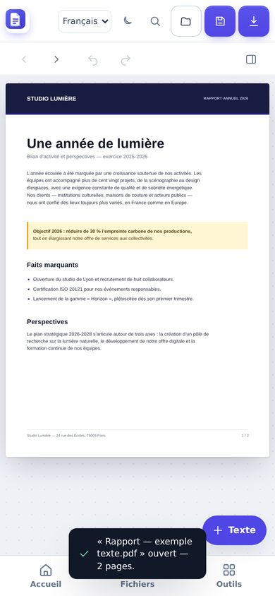
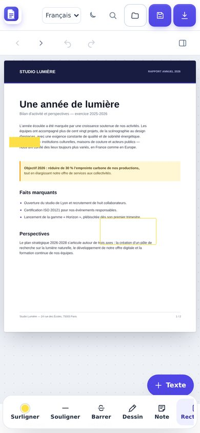
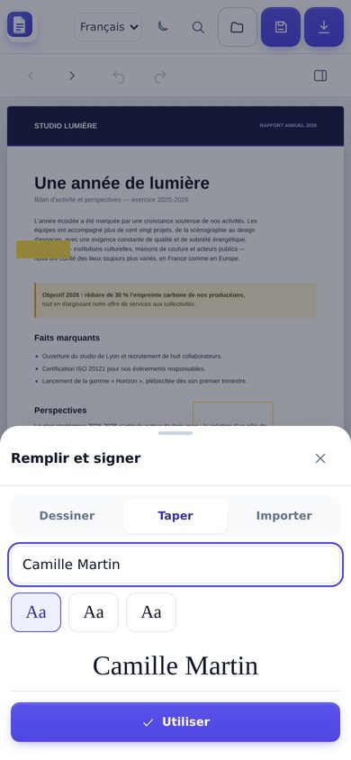
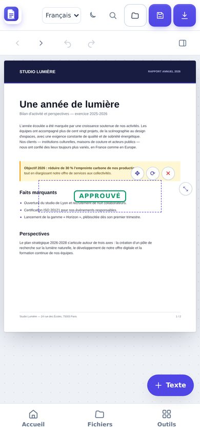
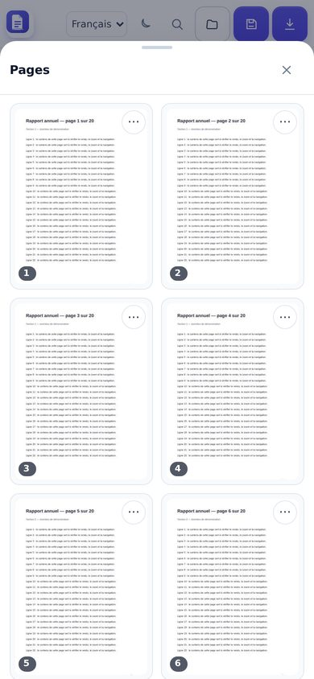
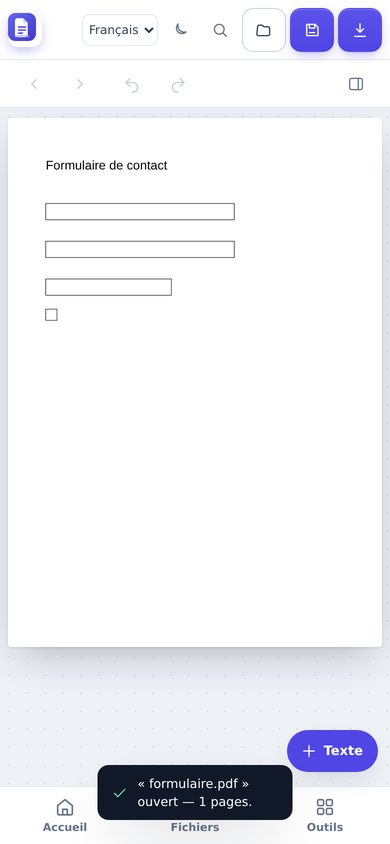
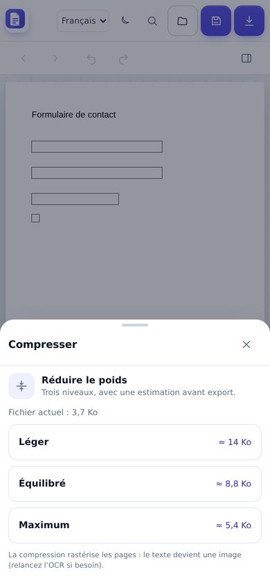
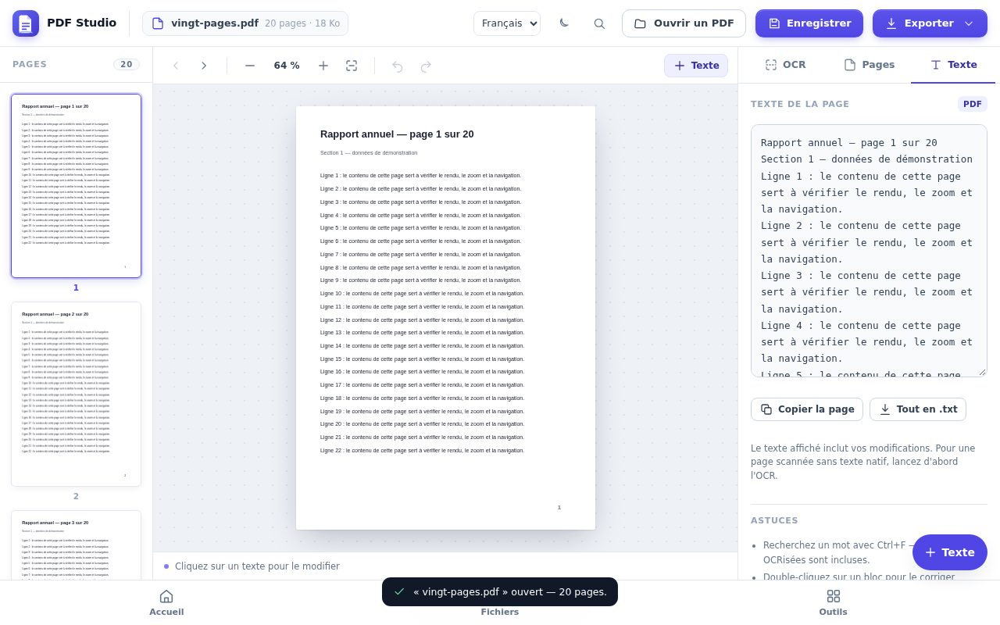
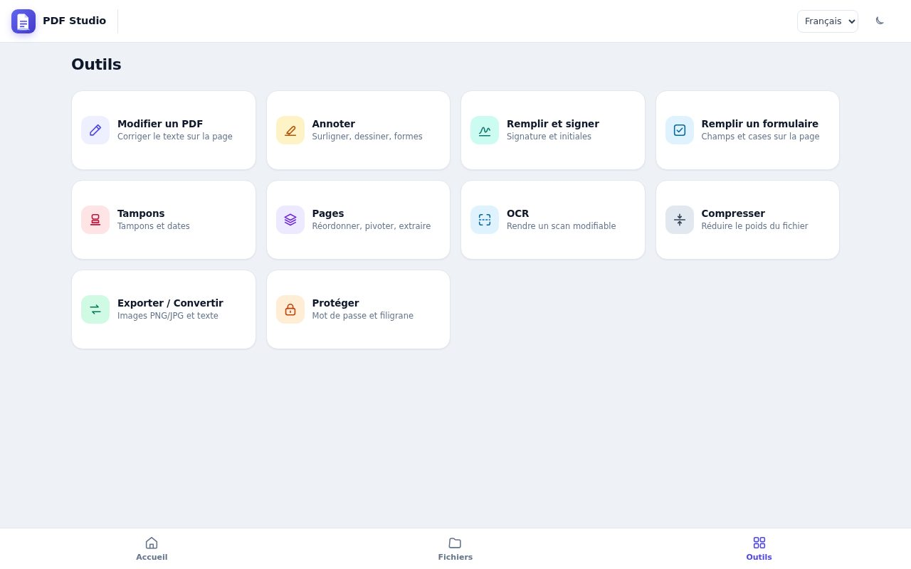
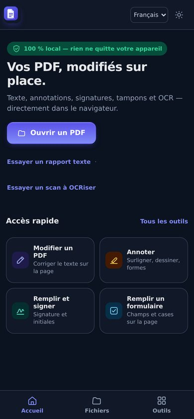

# PDF Studio — OCR & édition de PDF · V2.1

Application web **100 % locale** : ouvrez un PDF, cliquez sur un texte pour le corriger, lancez
l'OCR sur les pages scannées (français + anglais) puis exportez un PDF modifié et/ou une couche de
texte recherchable.

Aucun fichier n'est envoyé sur un serveur : le rendu, l'OCR, l'édition et l'export s'exécutent
entièrement dans le navigateur.

| Accueil (mobile) | Document (mobile) | Annotations (mobile) |
| --- | --- | --- |
|  |  |  |

| Signature | Tampon | Pages |
| --- | --- | --- |
|  |  |  |

| Formulaire | Compression | Fichiers |
| --- | --- | --- |
|  |  |  |

| Ordinateur — document | Ordinateur — outils | Thème sombre |
| --- | --- | --- |
|  |  |  |

---

## Nouveautés de la V2

- **OCR local FR / EN** (Tesseract.js + modèles embarqués)
  - reconnaissance page par page ou sur tout le PDF, barre de progression, annulation ;
  - blocs de texte positionnés sur la page, sélectionnables et **éditables** ;
  - segmentation intelligente des colonnes et tableaux (chaque cellule reste indépendante).
- **Édition du texte**
  - réécriture d'une ligne existante ou ajout d'un bloc libre ;
  - police (Helvetica / Times / Courier), taille, gras, italique, couleur du texte ;
  - **couleur de fond échantillonnée automatiquement** pour masquer proprement l'original ;
  - **couleur du texte détectée** (un titre blanc sur fond sombre reste blanc) ;
  - option « ajuster la taille à la zone ».
- **Recherche** insensible à la casse et aux accents, dans le texte natif **et** le texte OCR.
- **Export**
  - suppression réelle du texte remplacé dans le flux de contenu (option par défaut) ;
  - mode « caviardé » qui rastérise la page pour garantir la disparition du texte ;
  - PDF avec les modifications appliquées ;
  - PDF avec couche OCR invisible (texte recherchable / sélectionnable) ;
  - les deux combinés ;
  - texte brut `.txt` de tout le document ;
  - fenêtre d'aperçu avec lien de téléchargement après génération.
- **Confort**
  - **annuler / rétablir** (boutons visibles + raccourcis) sur toutes les modifications ;
  - **sauvegarde automatique** des modifications et résultats OCR (IndexedDB) avec
    proposition « Reprendre le travail ? » à la réouverture du même fichier ;
  - ouverture des **PDF protégés par mot de passe** (saisie et nouvelle tentative) ;
  - messages explicites pour les PDF corrompus ou les fichiers trop lourds (limite 200 Mo) ;
  - chargement paresseux de Tesseract et de pdf-lib : **bundle initial ≈ 340 Ko gzip** ;
  - extraits d'exemple intégrés : rapport texte et facture scannée ;
  - vignettes de pages (rendu paresseux), zoom, navigation clavier ;
  - interface responsive (panneau latéral escamotable sur mobile).

## Nouveautés de la V2.1

- **Outils de pages** (onglet Pages) : rotation ±90°, déplacement (boutons ou glisser-déposer des
  vignettes), suppression, insertion d'une page vierge, extraction d'une sélection (`1-3,5`),
  division et fusion avec un autre PDF.
- **Formulaires AcroForm** : détection automatique des champs (texte, case à cocher, liste, boutons
  radio), remplissage dans le panneau Formulaire, export avec ou sans aplatissement.
- **OCR étendu** : français, anglais, espagnol, allemand et arabe ; amélioration du contraste et
  redressement automatique avant reconnaissance ; score de confiance affiché.
- **Export image** : page courante en PNG ou JPEG (qualité réglable), utile pour les aperçus.
- **Thème sombre** (bouton soleil/lune, détection du système, mémorisation), **ARIA** sur les
  onglets (navigation aux flèches, `aria-selected`) et cibles tactiles de 44 px.
- **PWA** : installable et utilisable hors ligne — service worker, manifeste et 4 icônes.
- **Interface trilingue** français / anglais / arabe (RTL), sélecteur dans la barre supérieure.
- **Zoom par pincement** sur écran tactile.

## Nouveautés de la V2.2 — édition sur la page

Toute l'édition se fait **directement sur le document**, comme dans Acrobat sur mobile : plus de
panneau latéral à ouvrir, la page occupe l'écran.

- **Modifier le texte sur la page** : toucher une ligne ouvre un champ à sa place, au-dessus du
  clavier ; la ligne est réellement réécrite (le texte d'origine est retiré du PDF à l'export).
- **Annoter** : barre du bas avec surlignage (4 couleurs), soulignement, texte barré, dessin libre
  (couleur et épaisseur), note, rectangle, ellipse et flèche ; gomme, annulation, tout est exporté
  en objets PDF réels.
- **Signer** : dessin au doigt, saisie (3 polices manuscrites), import d'une photo de signature avec
  suppression du fond ; bibliothèque locale ; déplacement, redimensionnement et rotation par
  poignées.
- **Tampons** : 9 modèles en français, date du jour et tampon personnalisé (texte + couleur), avec
  opacité et rotation.
- **Insérer** : photo (appareil photo sur téléphone), coche, croix, date du jour.
- **Remplir un formulaire** : les champs AcroForm deviennent éditables sur la page ; sans champ,
  les pointillés, les lignes de signature et les cases sont détectés et peuvent être remplis.
- **Pages** : grille plein écran avec vignettes, glisser-déposer pour réordonner, rotation,
  suppression, duplication, page vierge, extraction.
- **OCR en un geste**, **compression** avec estimation (léger / équilibré / maximum),
  **protection** par filigrane, **conversion** PNG / JPG / TXT.
- **Fichiers** : les documents sont conservés dans le navigateur (IndexedDB) — ouvrir, renommer,
  partager, supprimer. Les annotations font partie de la session sauvegardée.
- **Mobile d'abord** : navigation par onglets en bas, feuilles plein écran, cibles tactiles de
  44 px, **pincer pour zoomer**, **balayer pour changer de page**, thème sombre automatique,
  aide en 3 écrans au premier lancement.

---

## Tests

```bash
npm test          # Vitest — 58 tests
```

Les tests couvrent notamment :
- la recherche insensible à la casse/aux accents (index d'origine, ligatures œ/æ) ;
- `sanitizePdfText` et la couverture WinAnsi ;
- l'export : PDF valide, texte réellement remplacé (extrait avec pdf.js), couche OCR
  extractible, mode masque conservant l'ancien texte ;
- `pageOps` : analyse des plages (`1-3,5`), rotation, suppression, déplacement (contenu préservé),
  insertion, extraction, fusion ;
- `forms` : lecture des champs AcroForm, remplissage puis relecture, aplatissement ;
- `imagePrep` : étirement du contraste et estimation d'inclinaison sur un canvas simulé ;
- les **annotations** : normalisation des rectangles, tracé libre → chemin SVG, flèches, tampons ;
- l'**export fidèle** : surlignage, rectangle et encre effectivement dessinés, tampon et date
  retrouvés dans le texte extrait du PDF produit ;
- la **signature** : signature tapée (image générée), pad de dessin, bibliothèque locale ;
- `reorderPages` : réordonnancement réel des pages (vérifié en relisant le PDF produit).

La CI GitHub Actions exécute `npm test` puis `npm run build` avant chaque déploiement.

## Démarrage

```bash
npm install --legacy-peer-deps
npm run dev        # http://localhost:5173
```

> `--legacy-peer-deps` contourne un bug de résolution de npm 10 rencontré à l'installation.
> Toutes les dépendances sont déjà présentes dans `node_modules` si le projet vous est livré avec.

Build de production et prévisualisation :

```bash
npm run build      # génère dist/ (chemins relatifs, prêt pour GitHub Pages)
npm run preview    # http://localhost:4173
```

### Déploiement GitHub Pages

Le workflow `.github/workflows/deploy.yml` construit et publie automatiquement l'application à
chaque push sur `main` :

**https://azharshahim.github.io/pdf-studio-v2/**

`vite.config.js` utilise `base: './'` et tous les assets (`pdfjs`, `tessdata`, `tesseract`,
polices) sont résolus à l'exécution via `import.meta.env.BASE_URL`, ce qui permet au site de
fonctionner aussi bien à la racine que dans un sous-dossier.

### Compatibilité navigateurs

- pdf.js est importé depuis **`pdfjs-dist/legacy`**, qui embarque les polyfills nécessaires aux
  navigateurs sans `Map.prototype.getOrInsertComputed`, `Promise.try` ou `Promise.withResolvers`.
- `src/polyfills.js` complète ces API pour le reste de l'application (Safari < 17.4,
  Firefox < 128, anciens Chrome).
- Testé sur Chromium récent ; le build legacy couvre Safari iOS 15+ et Firefox ESR.

---

## Utilisation

1. **Ouvrir** un PDF avec le bouton, par glisser-déposer, ou tester un exemple depuis l'écran
   d'accueil.
2. **Éditer** : cliquez sur n'importe quelle ligne du document (curseur texte). Le panneau de
   droite permet de changer le contenu, la police, la taille, le style et les couleurs, puis
   **Valider**. « Rétablir l'original » supprime la modification.
3. **OCR** : onglet OCR → choisir la langue → « Cette page » ou « Tout le PDF ». Les blocs
   reconnus apparaissent en pointillés sur la page et deviennent éditables comme le texte natif.
4. **Exporter** : bouton Exporter → cocher « Appliquer les modifications » et/ou « Ajouter la
   couche OCR » → Télécharger le PDF. L'aperçu confirme le résultat.
5. **Pages** : onglet Pages → pivoter, déplacer (ou glisser-déposer une vignette), supprimer,
   insérer une page vierge, extraire une plage, diviser ou fusionner un autre PDF.
6. **Formulaire** : les champs AcroForm apparaissent dans leur onglet dès l'ouverture ; remplissez,
   choisissez d'aplatir ou non, puis « Exporter le PDF rempli ».
7. **Apparence et langue** : bouton lune/soleil pour le thème sombre, sélecteur de langue
   (français, anglais, arabe) dans la barre du haut.

### Raccourcis

| Raccourci | Action |
| --- | --- |
| `Ctrl/Cmd + O` | Ouvrir un PDF |
| `Ctrl/Cmd + F` | Rechercher |
| `Ctrl/Cmd + S` | Exporter le PDF |
| `Ctrl/Cmd + Z` | Annuler la dernière modification |
| `Ctrl/Cmd + Maj + Z` (ou `Ctrl+Y`) | Rétablir |
| `←` / `→` | Page précédente / suivante |
| `+` / `−` | Zoom avant / arrière |
| `Échap` | Fermer le panneau, annuler l'ajout de texte |
| `Ctrl/Cmd + Entrée` | Valider l'édition en cours |

---

## Architecture

```
pdf-studio/
├── index.html            # structure de l'interface
├── src/
│   ├── main.js           # application : viewer, édition, OCR, recherche, export, UI
│   ├── pdfEngine.js      # pdf.js : rendu, extraction de lignes + polices
│   ├── ocrEngine.js      # worker Tesseract partagé, parsing des blocs
│   ├── exporter.js       # pdf-lib : suppression du texte, Noto, couche OCR invisible
│   ├── textRemoval.js    # réécriture des opérateurs Tj/TJ dans les flux de contenu
│   ├── markup.js         # calque d'objets sur la page (annotations, tampons, images)
│   ├── signature.js      # pad de dessin, signatures tapées, bibliothèque locale
│   ├── tools.js          # grille de pages, compression, filigranes, en-têtes d'outils
│   ├── shell.js          # navigation (Accueil / Fichiers / Outils), feuilles, aide initiale
│   ├── pageOps.js        # rotation, suppression, déplacement, réordonnancement, extraction, fusion
│   ├── forms.js          # lecture et remplissage des champs AcroForm
│   ├── imagePrep.js      # contraste et redressement (deskew) avant OCR
│   ├── i18n.js           # interface français / anglais / arabe (RTL)
│   ├── search.js         # recherche sans accents + extraits surlignés
│   ├── history.js        # piles annuler / rétablir
│   ├── session.js        # sauvegarde IndexedDB (empreinte SHA-256 du PDF)
│   ├── ui.js             # toasts, chargement, dialogues
│   ├── polyfills.js      # API récentes pour navigateurs anciens
│   ├── samples.js        # PDF d'exemple (texte et scan) générés à la volée
│   ├── icons.js          # icônes SVG
│   ├── utils.js          # helpers
│   └── style.css         # design system et responsive
└── public/
    ├── pdfjs/            # polices standard, cmaps, wasm de pdf.js
    ├── tesseract/        # worker Tesseract.js
    ├── tesseract-core/   # moteurs wasm (variantes LSTM)
    └── tessdata/         # modèles de langue fra + eng (best_int)
```

### Modules

`main.js` reste le contrôleur de l'application (viewer, édition, OCR) et délègue :
- la **recherche** à `search.js` (fonctions pures testées) ;
- l'**historique** à `history.js` ;
- la **persistance de session** à `session.js` ;
- les **composants d'interface** (toasts, chargement, dialogues) à `ui.js` ;
- les **moteurs** à `pdfEngine.js`, `ocrEngine.js`, `exporter.js`, `textRemoval.js` ;
- les **opérations document** à `pageOps.js` (pages) et `forms.js` (formulaires) ;
- le **calque d'annotations** à `markup.js` (objets positionnés en points PDF, exportés en
  surlignages, traits, rectangles, tampons et images réels) ;
- les **signatures** à `signature.js` et les **écrans d'outils** à `tools.js` et `shell.js` ;
- le **prétraitement d'image** à `imagePrep.js` et les **traductions** à `i18n.js`.

### Pipeline d'édition

1. pdf.js extrait les fragments de texte avec leurs coordonnées, tailles et polices réelles
   (`page.commonObjs`).
2. Les fragments sont regroupés en lignes ; chaque ligne devient une zone cliquable.
3. À la sélection, la couleur du fond et la couleur dominante du texte sont échantillonnées sur le
   canvas déjà rendu.
4. À l'export, pdf-lib dessine un rectangle de masquage (couleur du fond) puis le nouveau texte aux
   coordonnées d'origine, avec la police standard la plus proche.
5. La couche OCR est ajoutée en texte invisible (`opacity: 0`) aux positions des mots reconnus,
   en sautant les zones déjà réécrites.

---

## Suppression du texte d'origine

Trois modes sont proposés dans le menu Exporter (champ « Texte d'origine ») :

| Mode | Effet | Quand l'utiliser |
| --- | --- | --- |
| **Retiré du flux** (défaut) | Les opérateurs `Tj`/`TJ` de la zone éditée sont supprimés du flux de contenu : le texte n'est plus extractible. | PDF générés par un logiciel classique (texte dans le flux de page). |
| **Caviardé (rastérisé)** | La page est rendue en image, la zone repeinte, puis le nouveau texte est ajouté. | PDF complexes, texte dans des XObjects, garantie absolue. |
| **Masqué seulement** | Ancien comportement : rectangle de couleur. Le texte reste extractible. | Débogage / préservation maximale du vecteur. |

Le mode « flux » est prudent : si un opérateur couvre visiblement plus que la ligne éditée, ou si
le flux utilise un filtre non géré, la page concernée bascule automatiquement sur le masque.

## Polices Unicode

Les polices **Noto Sans** (regular / bold / italic / bold-italic) et **Noto Naskh Arabic** sont
embarquées dans `public/fonts/` et intégrées avec `@pdf-lib/fontkit` :

- les accents rares, symboles et l'arabe sont conservés (au lieu d'être supprimés) ;
- le texte arabe est shapingé (formes contextuelles) puis réordonné en bidi avant le dessin ;
- les lignes mixtes arabe/latin sont découpées en segments et dessinées avec la police adaptée ;
- si un caractère n'existe dans **aucune** police embarquée (emoji, notations musicales…), un
  avertissement liste les caractères concernés **avant** de lancer l'export.

## Ce qui a été vérifié, et comment

Les tests automatiques (`npm test`, 58 tests) couvrent la logique pure : recherche, polices,
remplacement réel du texte, pages, formulaires, images, annotations, export des objets et
signatures. Ils ne remplacent pas un essai dans un vrai navigateur : les parcours ci-dessous ont
donc été rejoués dans **Chromium** au moyen de scripts Playwright, en 390 × 844 (téléphone,
tactile) et en 1280 × 800 (ordinateur).

| Parcours | Résultat |
| --- | --- |
| Ouvrir un PDF de 20 pages, zoom automatique à la largeur, navigation | 20 pages, zoom 64 % sur ordinateur, correct sur téléphone |
| Toucher une ligne, la réécrire, valider | champ en place, texte remplacé, export sans l'ancien texte |
| Annoter : surlignage, dessin, note, rectangle | 4 objets créés, exportés puis relus dans le PDF produit |
| Signer (saisie), tampon, coche, date | 4 objets, export `s5-signed.pdf` relu correctement |
| Remplir un formulaire AcroForm | 4 champs détectés, remplis, exportés |
| Pages : réordonner par glisser-déposer | ordre du PDF réellement modifié |
| OCR d'un scan en un geste | page océrisée, texte éditable |
| Compression (3 niveaux) | estimations affichées, fichier exporté |
| Langues FR / EN / AR (RTL) | libellés, cartes et feuilles traduits, aucune erreur console |
| Thème sombre automatique et manuel | couleurs appliquées, contrastes lisibles |
| Aide au premier lancement | 3 écrans, mémorisée après fermeture |
| Pincer pour zoomer, balayer pour changer de page | zoom 152 % après pincement, page suivante après balayage |

**Ce qui n'a pas pu être testé ici** : Safari sur iPhone et iPad, Firefox, les appareils photo
réels (l'entrée caméra est un simple champ fichier), le partage natif (`navigator.share`, absent du
navigateur de test), l'installation PWA et le mode hors ligne (service worker inactif en
développement), l'ouverture de PDF réellement chiffrés par mot de passe, et la qualité de l'OCR
au-delà des deux exemples fournis.

## Limites connues

- **Texte dans les objets de formulaire (XObjects)** : le mode « flux » ne parcourt que le flux
  principal de la page. Ces textes ne sont pas retirés ; utilisez le mode « caviardé ».
- **Texte d'origine et copier-coller** : en mode « masqué seulement », l'ancien texte reste dans le
  PDF. Les modes « flux » et « rastérisé » corrigent ce point.
- **Arabe** : les ligatures complexes et certaines mises en forme (kashida, diacritiques rares)
  peuvent être approximées ; la sélection du texte arabe exporté renvoie des formes de présentation.
- Le rendu est optimal lorsque le fond est uniforme (papier, aplat de couleur). Sur les photos ou
  dégradés, le rectangle de masquage peut être perceptible.
- Les polices d'origine ne sont pas embarquées : l'édition utilise Helvetica, Times ou Courier,
  choisies automatiquement d'après la police détectée.
- Les PDF protégés par mot de passe sont ouverts après saisie du mot de passe ; les PDF
  chiffrés avec un algorithme exotique peuvent échouer.
- Les fichiers de plus de 200 Mo sont refusés (au-delà de 60 Mo, un avertissement s'affiche).
- La qualité de l'OCR dépend de la résolution et de la propreté du scan.

---

## Personnaliser les langues OCR

Les modèles fournis dans `public/tessdata/` couvrent le **français, l'anglais, l'espagnol,
l'allemand et l'arabe** (`fra`, `eng`, `spa`, `deu`, `ara`). Pour ajouter une langue :

1. déposer `<lang>.traineddata.gz` dans `public/tessdata/` ;
2. ajouter la langue dans `SUPPORTED_LANGS` / `LANG_MAP` (`src/ocrEngine.js`) et une case dans
   `#ocrLang` (`index.html`).

Les modèles fournis sont les **best_int** de tessdata (bon compromis taille / précision).

---

## Crédits

- [pdf.js](https://mozilla.github.io/pdf.js/) — Apache-2.0
- [pdf-lib](https://pdf-lib.js.org/) — MIT
- [Tesseract.js](https://tesseract.projectnaptha.com/) — Apache-2.0
- [tessdata](https://github.com/tesseract-ocr/tessdata) — Apache-2.0
- Icônes et illustrations : SVG originaux.

Traitement 100 % local — aucune donnée ne quitte votre navigateur.
